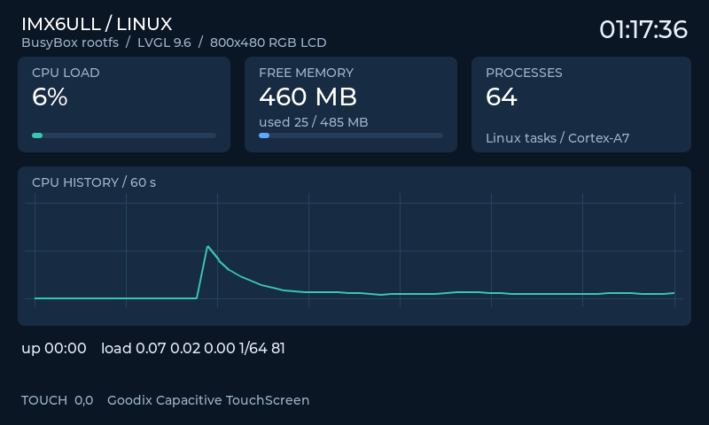

# imx6ull_port —— 正点原子 i.MX6ULL Mini 主线移植工程

把 U-Boot、Linux、BusyBox、LVGL 四层都用**上游最新版本**重新移植到 **Alientek i.MX6ULL Mini**
（Cortex-A7 / 512 MiB DDR / ATK-4.3 RGBLCD 800×480 / GT911 触摸），并可直接接入仓库统一的
QEMU 虚拟开发板（`04_Linux_and_QEMU/02_QEMU_Workspace/qemu`）做回归。

仓库里只放板级适配与构建脚本，**不塞上游源码**（内核/图形库上 GB，靠 `tools/fetch-sources.sh`
按钉死的版本拉取），别人 clone 下来三步就能编。

## 版本矩阵

| 组件 | 版本 | 上游来源 |
| --- | --- | --- |
| U-Boot | **v2026.10**（2026-10-05） | github.com/u-boot/u-boot tag `v2026.10`（最新稳定；`v2027.01-rc3` 仍是 RC，未采用） |
| Linux | **7.3.6**（2026-11-23） | kernel.org `linux-7.3.6.tar.xz`，sha256 `8183d475…d45723` |
| BusyBox | **1.38.0** | busybox.net 官方 tar.bz2，静态链接 |
| LVGL | **9.6.0** | github.com/lvgl/lvgl tag `v9.6.0` |
| 交叉工具链 | arm-linux-gnueabihf-gcc **13.3.0** 及以上 | Ubuntu/Debian `gcc-arm-linux-gnueabihf` |
| QEMU | **11.1.0**，机型 `mcimx6ull-alientek` | 仓库 `qemu/bin/qemu-system-arm-im6` |

## 目录

```
imx6ull_port/
├── board/                  板级配置（唯一“魔改”来源，全部可审阅）
│   ├── u-boot/0001-mx6ull-alientek-mini-port.patch   defconfig + dts + soc.c（QEMU 兼容）
│   ├── u-boot/mx6ull_alientek_mini_defconfig
│   ├── linux/kernel.config           从旧固件 IKCFG 段反推出的真实 .config
│   ├── linux/imx6ull-alientek-mini-4.3.dts
│   └── busybox/busybox.config
├── rootfs/                 initramfs 的 /init、rcS、inittab、fstab、profile
├── app/lvgl/               800×480 仪表盘（main/display/input/ui + lv_conf.h）
├── tools/
│   ├── fetch-sources.sh    拉 4 份上游源码并套 board/ 配置
│   ├── build-all.sh        一键构建，产物到 out/
│   ├── install-to-qemu.sh  按统一命名装进 qemu/images
│   ├── verify-qemu.sh      统一 QEMU 冷启动 + 抓屏
│   └── ppm2png.py
├── docs/
│   ├── porting.md          移植文档（逐项适配说明）
│   ├── pitfalls.md         踩坑记录（12 条）
│   ├── recovery.md         旧固件产物反推过程（7.3.5 时代）
│   └── qemu-boot.png/.log  最近一次验证证据
├── patches/                与 board/u-boot 相同的补丁（便于 git format-patch 习惯）
├── recovered/              反编译得到的 dts 与抽出的内核 config（溯源用）
├── reference/              旧板固件原件（7.3.5 时代，仅作对照，不参与构建）
└── src/  out/              上游源码与产物（.gitignore，见下）
```

## 快速开始

依赖（Debian/Ubuntu）：

```bash
sudo apt install build-essential bison flex bc libssl-dev cpio gzip u-boot-tools \
                 gcc-arm-linux-gnueabihf device-tree-compiler
```

三步：

```bash
git clone https://github.com/xuliyan0099/imx6ull-mini-mainline.git imx6ull_port && cd imx6ull_port
bash tools/fetch-sources.sh      # 下载 pinned 上游源码到 src/，套用 board/ 配置
bash tools/build-all.sh          # 编 U-Boot / 内核 / LVGL / BusyBox，产物在 out/
```

内网或离线镜像：`fetch-sources.sh` 支持 `IM6_UB_URL / IM6_LX_URL / IM6_BB_URL / IM6_LV_URL`
指向镜像地址，`IM6_SRC` 可改源码目录；`IM6_FORCE=1` 强制重拉。

部分网络访问 busybox.net 会被 TLS 重置，脚本会自动回退到 Buildroot / Alpine 的 distfiles 镜像；
都不通时把包下到本地，用 `IM6_BB_FILE=/path/busybox-1.38.0.tar.bz2`（内核同理 `IM6_LX_FILE`）指定。

编译慢的话把 `src/` 放到本地 ext4 盘（如 `IM6_SRC=/tmp/im6-src`），别放在 Windows 的 9p 挂载盘上。

## 接入统一 QEMU

```bash
IM6_QEMU=<qemu 工程目录> bash tools/install-to-qemu.sh
IM6_QEMU=<qemu 工程目录> bash tools/verify-qemu.sh      # 无浏览器自检 + 抓屏
```

`install-to-qemu.sh` 把三个产物按网页虚拟开发板认的名字落到 `qemu/images/`
（`zImage-mini-upstream` / `imx6ull-alientek-mini-4.3.dtb` / `rootfs-mini.uimg`，覆盖前留 `.previous`）。
之后打开 `qemu/scripts/run-virtual-board.cmd`，配置选 **「Linux / imx6ull_port（LVGL 9.6）」**，
服务会在 U-Boot 里自动执行与真板一致的手工序列：

```text
mmc dev 0
fatload mmc 0:1 0x80800000 zImage
fatload mmc 0:1 0x83000000 mini.dtb
fatload mmc 0:1 0x84000000 initrd.uim
setenv bootargs console=ttymxc0,115200 root=/dev/ram0 rw
bootz 0x80800000 0x84000000 0x83000000
```

`IM6_QEMU` 不指定时脚本会沿仓库上两级找 `04_Linux_and_QEMU/02_QEMU_Workspace/qemu`，
找不到就报错退出——不会写死某台机器的路径。

## 烧到真板

`out/` 里四个文件对应：

| 产物 | 烧写位置 |
| --- | --- |
| `u-boot-dtb.imx` | SD/eMMC 偏移 0x400（IVT），用 `dd` 或 MfgTool |
| `zImage`、`imx6ull-alientek-mini-4.3.dtb` | 第一分区 `/boot/`（U-Boot `ext4load ... /boot/zImage`） |
| `rootfs-mini.uimg` | 可选：initramfs 方式启动时 `fatload` 到 0x84000000；常驻系统可解包成 ext4 根分区 |

## 验证结果（2026-11-25，QEMU 11.1.0 / mcimx6ull-alientek）

- U-Boot：`U-Boot 2026.10`、`Model: Alientek i.MX6ULL Mini`、`DRAM: 512 MiB`、`FSL_SDHC: 0, 1` → `=>`。
- 内核：7.3.6 起，`imx6ull-mini: rootfs ready`，`ttymxc0` 出 shell。
- LVGL：800×480 全屏仪表盘（CPU/内存/进程三卡、60 秒曲线、uptime），触摸识别 `Goodix Capacitive TouchScreen`。
- DTB 与旧固件逐字节一致（sha256 `1a41ee56…f95f9a`），说明设备树还原准确。



## 已知限制

- QEMU 不实现 `imx_thermal` 校准数据与 `pwm-backlight`，日志有两条 probe 失败，不影响显示。
- QEMU 里 GT911 报点为模型行为；真板方向修正用 `LVGL_TOUCH_SWAP / INVERT_X / INVERT_Y`。
- 未提供 eMMC 整盘烧写镜像，`uboot-emmc.img` 仍是既有基座。
- `lvgl_demo` 用静态 glibc 链接；若要塞进厂商动态 rootfs，改用 `arm-poky-linux-gnueabi-` SDK 编（见 `docs/porting.md`）。

许可：本仓库自写脚本与板级配置按 MIT；上游源码各自遵循其原许可（GPL-2.0 / GPL-2.0+ / MIT）。
