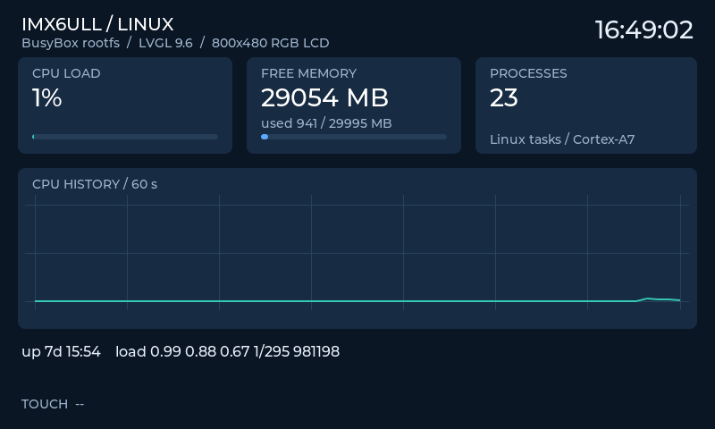

# LVGL 9.6 仪表盘（i.MX6ULL Mini，ATK-4.3 800×480）

跑在 BusyBox initramfs 上的全屏仪表盘：不依赖 X11 / Wayland / Qt，直接写 `/dev/fb0`、
直接读 `/dev/input/event*`，屏幕按 800×480 满屏设计。



## 编译

在仓库根目录先拉好源码（`src/lvgl` 为 LVGL 9.6.0）：

```bash
bash tools/fetch-sources.sh          # 首次
make -C app/lvgl static CC=arm-linux-gnueabihf-gcc STRIP=arm-linux-gnueabihf-strip \
     LVGL_DIR=$PWD/src/lvgl
# 产物 app/lvgl/lvgl_demo，静态链接，约 849 KB
```

只想要主机预览（不用板子）：`make -C app/lvgl preview`，生成 `preview.png`。

`LVGL_DIR` 默认指向 `<repo>/src/lvgl`，也可以用环境变量覆盖成任意 LVGL 9.6 源码目录。

## 界面内容

- 顶栏：`IMX6ULL / LINUX`、当前时间
- 三张卡：CPU 占用（`/proc/stat` 差值 + 指数平滑）、空闲内存（`/proc/meminfo` MemAvailable）、进程数（`/proc` 数字目录计数）
- CPU 60 秒历史曲线（1 秒一个点）
- 底部：uptime、`/proc/loadavg`、触摸坐标与设备名
- 配色：背景 `0x0b1625`、卡片 `0x172b42`、青 `0x36c8b3`、蓝 `0x5ca7ff`

## 代码结构

| 文件 | 职责 |
| --- | --- |
| `src/main.c` | `lv_init()`、tick、主循环 `lv_timer_handler()` |
| `src/display.c` | `mmap` `/dev/fb0`，读 `FBIOGET_VSCREENINFO`，40 行分块 flush；XRGB8888 直拷，16bpp 转 RGB565 |
| `src/input.c` | 扫 `/dev/input/event0..9` 找带 `ABS_X/ABS_Y` 的设备，`EVIOCGABS` 原始范围映射 |
| `src/ui.c` | 800×480 布局与 `/proc` 数据采集 |
| `config/lv_conf.h` | 4 MB 内存池、`LV_COLOR_DEPTH 32`、Montserrat 14/16/20/28 |

## 运行与调试

rootfs 的 `/etc/init.d/rcS` 会在后台拉起 `/usr/bin/lvgl_demo`，日志写 `/var/log/lvgl.log`。

```sh
/usr/bin/lvgl_demo                 # 手动前台跑
killall lvgl_demo                  # 停止
LVGL_TOUCH_SWAP=1 /usr/bin/lvgl_demo          # 触摸方向修正
LVGL_TOUCH_INVERT_X=1 LVGL_TOUCH_INVERT_Y=1 /usr/bin/lvgl_demo
```

## 已知限制

- 只带 Montserrat（ASCII），中文要另用 `lv_font_conv` 生成字库。
- 布局写死 800×480；换 480×272 屏需另做紧凑版。
- 纯软件渲染，QEMU 空载约 14% CPU；真板 Cortex-A7 会低一些。
- QEMU 的 GT911 模型只暴露单点，界面会显示 `TOUCH 0,0`，真板才有真实坐标。
